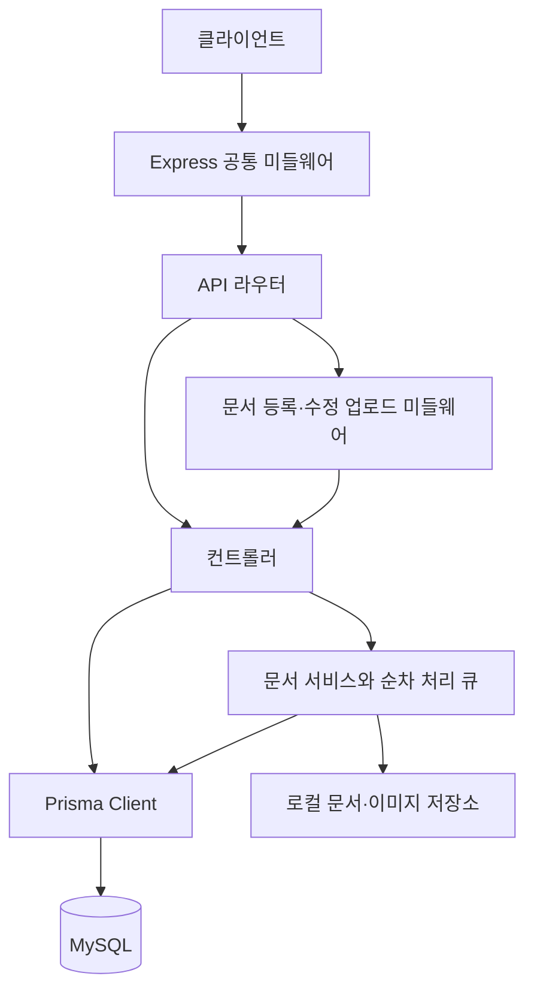

# Architecture

이 문서는 현재 저장소의 코드와 스키마를 기준으로 정리한 아키텍처이다. "확인된 사실"은 코드, Prisma 스키마, 기존 문서에서 직접 확인한 내용이고, "추정/추가 확인 필요"는 배포 환경이나 제품 정책처럼 저장소만으로 확정할 수 없는 내용이다.

구조 설명은 이 문서를 기준으로 관리한다. 조사 과정과 미확정 질문은 [research.md](./research.md)에 남기고, 도메인 기능 개요는 [spec.md](./spec.md), 엔드포인트와 요청·응답은 각 `*-api.md`를 기준으로 관리한다. 문서 게시판의 기준 명세는 [mkbrd-api.md](./mkbrd-api.md)이다.

## 프로젝트 개요

### 확인된 사실

- 개인 도서관리 서비스의 백엔드 API이다.
- 런타임은 Node.js, 웹 프레임워크는 Express, 언어는 TypeScript이다.
- 데이터베이스는 MySQL이고 Prisma Client/Prisma Migrate를 사용한다.
- 인증은 `express-session` 기반 세션과 `bcrypt` 비밀번호 해시로 구현되어 있다.
- 주요 기능은 인증, 도서 CRUD, 독서 기록 CRUD, 메모/하이라이트 CRUD, 통계 조회, Markdown 문서와 이미지 ZIP 관리이다.
- API 기본 경로는 `/api`, 헬스 체크 경로는 `/health`이다.

## 시스템 구성 요약

### 확인된 사실

요청 흐름은 다음과 같다.



- `index.ts`는 앱 생성, 미들웨어 등록, `/health`, `/api`, 404/에러 핸들러 등록, `app.listen`을 담당한다.
- `routes/index.ts`는 도메인별 라우트를 컨트롤러에 연결한다. 문서 등록·수정에는 업로드 미들웨어를 먼저 적용한다.
- 인증·도서·독서 기록·메모·통계는 컨트롤러가 Prisma Client를 직접 호출한다. 문서 게시판은 `services/`에서 DB·파일 작업을 처리하며 목록 조회는 컨트롤러에서 Prisma를 호출한다. 별도 repository 계층은 없다.
- `config/prisma.ts`는 `new PrismaClient()` 인스턴스를 기본 export한다.
- 공통 오류 미들웨어는 `middleware/errorHandler.ts`에 있다.

## 주요 디렉터리와 책임

### 확인된 사실

| 경로 | 책임 |
| --- | --- |
| `index.ts` | Express 앱 구성과 서버 시작 |
| `routes/` | API 라우팅 정의 |
| `controllers/` | 요청 검증, DB 직접 접근 또는 서비스 호출, 응답 생성 |
| `services/mkbrdService.ts` | 문서·이미지 저장과 조회, 작성자·이력 처리, 순차 실행, 폴더 복구 |
| `services/mkbrdImages.ts` | ZIP 경로·형식·크기·CRC 검증과 순차 압축 해제 |
| `services/mkbrdError.ts` | 문서 API의 HTTP 상태를 포함하는 오류 타입 |
| `middleware/mkbrdUpload.ts` | 로그인 확인, multipart 파싱, 문서·ZIP 업로드 제한 |
| `mkbrd/` | 로컬 문서·이미지 저장소, Git 제외 |
| `config/prisma.ts` | Prisma Client 인스턴스 생성 |
| `middleware/errorHandler.ts` | 404 응답과 일반 에러 응답 처리 |
| `schema.prisma` | Prisma 데이터 모델, enum, MySQL datasource, client generator 정의 |
| `migrations/` | Prisma 마이그레이션 SQL |
| `types/session.d.ts` | `express-session`의 `SessionData` 타입 확장 |
| `docs/` | 서비스/API 명세, 테스트용 SQL, 이 아키텍처 문서 |
| `test/` | Jest/Supertest 기반 API 테스트와 테스트 계획서 |
| `graphify-out/` | 코드/문서 그래프 분석 산출물로 보이는 파일들 |

### 추정/추가 확인 필요

- `graphify-out/`은 런타임에는 필요하지 않은 분석 산출물로 보이지만, 배포 산출물에서 제외되는지 여부는 별도 설정이 확인되지 않았다.

## 애플리케이션 진입점

### 확인된 사실

- 개발 실행: `npm run dev` -> `ts-node-dev --respawn --transpile-only index.ts`
- 빌드: `npm run build` -> `tsc`
- 운영 실행: `npm start` -> `node dist/index.js`
- TypeScript 출력 디렉터리는 `dist/`이고, `package.json`의 `main`도 `dist/index.js`이다.
- 기본 포트는 `process.env.PORT || 4000`이다.
- CORS origin은 `process.env.CLIENT_URL || 'http://localhost:3000'`이다.
- `.env`는 `dotenv.config()`로 로드된다.

## 주요 모듈과 의존 관계

### 확인된 사실

- `index.ts`
  - `express`, `cors`, `morgan`, `dotenv`, `express-session`에 의존한다.
  - `routes/index.ts`, `middleware/errorHandler.ts`를 등록한다.
- `routes/index.ts`
  - 모든 컨트롤러를 import하고 URL/HTTP method를 매핑한다.
  - 문서 등록·수정에 `documentUpload`를 적용한다. 나머지 인증 검사는 해당 컨트롤러에서 수행한다.
- `controllers/authController.ts`
  - `bcrypt`와 Prisma `user`, `loginHistory` 모델을 사용한다.
  - 로그인 성공 시 `req.session.userId`, `req.session.email`을 저장한다.
- `controllers/bookController.ts`
  - Prisma `book` 모델과 연관 `readingLogs`, `memos` count를 사용한다.
  - 목록 조회에서 상태, 장르, 검색어, 독서 상태, 독자명, 정렬, 페이지네이션을 처리한다.
- `controllers/readingLogController.ts`
  - Prisma `readingLog` 모델을 사용한다.
  - `bookId` 경로 파라미터로 도서별 기록을 생성/조회한다.
- `controllers/memoController.ts`
  - Prisma `memo` 모델을 사용한다.
  - `type` query/body로 `MEMO`와 `HIGHLIGHT`를 구분한다.
- `controllers/statsController.ts`
  - 세션을 직접 확인한다.
  - Prisma `book.groupBy`, `readingLog.findMany`, `readingLog.aggregate`, `book.count`를 사용해 통계를 만든다.
- `controllers/mkbrdController.ts`
  - 카테고리·파일명·UTF-8·경로 파라미터를 검증하고 `mkbrdService`를 호출한다.
  - 목록 페이징·카테고리 필터와 이미지 바이너리 응답을 제공한다.
  - 이미지에는 Content-Type, nosniff, CSP, no-cache 헤더를 설정한다.
- `middleware/mkbrdUpload.ts`
  - 세션을 확인한 다음 multer MemoryStorage로 `file`과 `images`를 각각 한 개씩 받는다.
  - multipart의 한글 파일명은 UTF-8로 해석하고 파일별 최대 10MB를 적용한다.
- `services/mkbrdService.ts`
  - Prisma `mkbrd`, `mkbrdHist`, 작성자 조회용 `user` 모델과 로컬 파일시스템을 사용한다.
  - 모듈 내부 Promise 큐로 문서·이미지 조회와 변경을 순차 실행한다.
- `services/mkbrdImages.ts`
  - yauzl로 ZIP을 순차 처리하고 stream pipeline으로 압축 해제한다.
  - Node.js `zlib.crc32`로 각 이미지의 무결성을 확인한다.
- `middleware/errorHandler.ts`
  - 라우트 미매칭은 JSON 404로 처리한다.
  - 에러 핸들러는 스택을 콘솔에 출력하고 JSON 500을 반환한다.

## 데이터 모델 또는 데이터 흐름 요약

### 확인된 사실

Prisma 모델은 다음과 같다.

| 모델 | 주요 필드 | 관계/제약 |
| --- | --- | --- |
| `User` | `id`, `email`, `password`, `createdAt` | `email` unique, DB 테이블명 `users` |
| `LoginHistory` | `id`, `email`, `success`, `ipAddress`, `attemptAt` | 로그인 시도 기록, DB 테이블명 `login_history` |
| `Book` | `title`, `author`, `publisher`, `isbn`, `genre`, `coverUrl`, `purchaseDate`, `status` | `isbn` unique, `ReadingLog[]`, `Memo[]`, DB 테이블명 `books` |
| `ReadingLog` | `bookId`, `userName`, `readStatus`, `rating`, `review` | `Book`과 N:1, `onDelete: Cascade`, DB 테이블명 `reading_logs` |
| `Memo` | `bookId`, `page`, `content`, `type` | `Book`과 N:1, `onDelete: Cascade`, DB 테이블명 `memos` |
| `Mkbrd` | `id`, `category`, `title`, `size`, `createdAt`, `updatedAt` | `(category, title)` unique, DB 테이블명 `mkbrd` |
| `MkbrdHist` | `id`, `documentId`, `userId`, `action`, `createdAt` | `(documentId, createdAt)` 인덱스, DB 테이블명 `mkbrd_hist` |

Enum은 다음과 같다.

- `BookStatus`: `OWNED`, `SOLD`, `DONATED`
- `ReadStatus`: `READ`, `EXCLUDED`
- `MemoType`: `MEMO`, `HIGHLIGHT`

주요 데이터 흐름:

- 회원가입: request body email/password -> 중복 이메일 확인 -> bcrypt hash -> `users` insert -> 비밀번호 제외 응답
- 로그인: email/password -> 사용자 조회 -> bcrypt compare -> 성공/실패와 IP를 `login_history`에 기록 -> 성공 시 세션에 user id/email 저장
- 도서 목록: query parameter -> Prisma `where/orderBy/skip/take` 구성 -> 도서, 독서 기록 요약, 메모 수, total 반환
- 도서 상세: `books.id` -> 도서, 전체 독서 기록, 최신순 메모 반환
- 독서 기록/메모: `bookId` 또는 항목 `id` -> Prisma create/update/delete/findMany
- 문서 상세: 메타데이터 조회 -> 파일 읽기 -> 최초 등록 이력의 `userId`로 현재 사용자 이메일 조회 -> `content`, `imageBaseUrl`, `authorEmail` 반환
- 문서 작성자: `action=등록` 이력 중 ID가 가장 작은 기록으로 판별한다. 수정자와 무관하며 이력 또는 사용자가 없으면 `authorEmail=null`이다. 이메일은 상세에만 포함한다.
- 문서 이력: 작업 성공 시 세션의 `userId`와 `등록`·`수정`·`삭제`를 기록한다. 문서와 사용자에 대한 FK는 없으며 문서 삭제 이후에도 이력을 보존한다.
- 통계: 세션 사용자 확인 -> 전체 도서 집계 + 전체 평균 별점 + 로그인 사용자 이메일과 `readingLogs.userName`이 일치하는 `READ` 기록의 연도별 집계

### 추정/추가 확인 필요

- `ReadingLog.userName`은 이름처럼 보이지만 통계에서는 로그인 사용자의 email과 비교한다. 프론트엔드 또는 운영 데이터에서 이 필드에 이메일을 저장하는 정책인지 확인이 필요하다.
- 별점 범위는 문서상 `0.0 ~ 5.0`이나 Prisma/컨트롤러 레벨에서 범위 검증은 확인되지 않았다.

## 문서·이미지 저장과 변경 흐름

카테고리는 `AI`, `관리`, `설계`, `기타`이다. DB에는 메타데이터만 저장하고 본문과 이미지는 파일로 저장한다. `size`는 이미지 크기를 제외한 Markdown 원본의 바이트 수이다.

```text
mkbrd/
└── <카테고리>/
    └── <확장자를 제외한 문서명>/
        ├── <파일명>.md
        └── image/
            └── <ZIP 내부 상대 이미지 경로>
```

### 등록·수정

1. `documentUpload`가 로그인 세션과 multipart 형식을 확인한다. 문서는 `file`, 이미지 ZIP은 선택 필드인 `images`로 받으며 각각 최대 10MB이다.
2. 컨트롤러가 카테고리·문서 파일명·본문 UTF-8과 ZIP 확장자를 검증한다. 등록은 카테고리와 문서가 필수이고 수정은 카테고리·문서·이미지 중 하나 이상 필요하다.
3. 프로세스 내 큐에서 현재 문서를 확인하고 대상 카테고리에 `.mkbrd-<UUID>.tmp` 임시 폴더를 만든다. 문서는 원본 바이트로 저장하고 `image/`를 생성한다.
4. ZIP이 있으면 임시 `image/`에 압축 해제한다. ZIP이 없으면 기존 이미지를 복사한다. 이 작업은 DB 트랜잭션 시작 전에 수행한다.
5. 하나의 Prisma 트랜잭션에서 메타데이터를 생성·수정하고, 기존 문서 폴더를 `.mkbrd-<UUID>.bak`으로 이동한 다음 임시 폴더를 대상 문서명 폴더로 이동한다. 같은 트랜잭션에서 작업 이력도 기록한다.
6. 성공하면 백업·임시 폴더를 정리한다. 오류 시 DB는 롤백하고 파일 변경을 역순으로 복구한다. 파일 복구 자체가 실패하면 백업을 남기고 오류를 반환한다.

ZIP을 첨부한 수정은 기존 이미지 전체를 교체한다. ZIP 생략 시 이미지를 유지하며 빈 ZIP은 이미지를 모두 비우는 용도로 사용할 수 있다. 카테고리·문서명 변경 시 문서와 이미지 폴더를 함께 이동한다.

### ZIP 검증

- yauzl의 순차 엔트리·크기 검증과 스트림을 사용한다. 압축 해제 후 총 100MB, 파일·디렉터리 항목 최대 1000개로 제한한다.
- 경로 탈출, 절대 경로, 역슬래시, 예약 파일명, 링크·특수 파일, 암호화, 정규화·대소문자 기준 중복 경로를 거부한다.
- `png`, `jpg`, `jpeg`, `gif`, `webp`, `avif`, `bmp`, `ico`, `svg` 확장자를 허용한다. 이미지 자체의 포맷 디코딩이 아닌 확장자 기준 검증이며 각 ZIP 항목의 CRC를 검사한다.
- ZIP 내부 경로를 `image/` 아래에 그대로 유지하며 ZIP 원본은 보관하지 않는다.

### 조회·삭제·기존 경로 호환

- 상세 조회는 Markdown과 작성자 이메일을 반환한다. 이미지 조회 기본 URL은 `/api/mkbrd/:id/image/`이며 경로를 검증하고 이미지 파일을 읽어 바이너리로 응답한다.
- 이미지 조회도 같은 큐를 사용해 문서 폴더 교체와 겹치지 않게 한다. 프런트엔드는 Markdown의 `image/` 상대 경로를 상세 응답의 `imageBaseUrl` 기반 URL로 변환한다.
- 삭제는 DB 메타데이터 삭제·삭제 이력 기록과 기존 폴더의 백업 이동을 트랜잭션 안에서 처리하고, 커밋 후 백업 폴더 전체를 제거한다. 삭제 요청에 ZIP 첨부는 필요하지 않다.
- 이전 버전의 평면 경로 `mkbrd/<카테고리>/<파일명>`도 조회·삭제할 수 있으며 수정 시 새 폴더 구조로 전환한다.

### 운영 경계

큐는 단일 프로세스에만 적용되므로 문서 기능은 단일 서버 프로세스로 운영한다. 다중 프로세스·인스턴스 간 파일 변경 동기화는 구현되어 있지 않다.

저장 루트는 `process.cwd()` 기준이므로 개발·빌드 실행 모두 프로젝트 루트에서 수행하고 쓰기 권한을 부여한다. `mkbrd/`는 Git 추적에서 제외되며 DB와 함께 백업하고 배포 간 유지해야 한다.

DB 트랜잭션은 파일시스템까지 원자성을 제공하지 않는다. 요청 중 오류에는 복구 절차가 적용되지만 프로세스 강제 종료·서버 장애 시에는 DB와 남은 `.tmp`·`.bak` 폴더를 비교해 수동 복구가 필요할 수 있다.

## 외부 시스템 연동 지점

### 확인된 사실

- MySQL: `DATABASE_URL` 환경변수로 Prisma datasource가 연결한다.
- 프론트엔드/브라우저 클라이언트: CORS `CLIENT_URL` origin과 credentials를 허용한다.
- 로컬 파일시스템: `process.cwd()` 기준 `mkbrd/`에 문서와 압축 해제된 이미지를 저장한다.
- 세션 쿠키: `express-session`이 기본 쿠키명 `connect.sid`를 사용한다.
- bcrypt: 비밀번호 해시와 검증에 사용한다.
- morgan: HTTP 요청 로그를 stdout에 출력한다.

### 추정/추가 확인 필요

- 파일은 프로젝트의 로컬 `mkbrd/`에 저장하며 외부 오브젝트 스토리지 연동은 없다. 외부 도서 검색 API, 이메일 발송, OAuth 연동도 확인되지 않았다.
- `express-session`의 store 설정이 없으므로 기본 MemoryStore를 사용하는 것으로 보인다. 운영 환경에서는 별도 세션 저장소가 필요한지 확인해야 한다.

## 인증, 권한, 보안 고려사항

### 확인된 사실

- 비밀번호는 `bcrypt.hash(password, 10)`으로 저장한다.
- 로그인 성공 시 세션에 `userId`, `email`을 저장한다.
- `GET /api/auth/me`는 `req.session.userId`, `GET /api/stats`는 `req.session.userId`와 `req.session.email`을 확인한다.
- 문서 목록·상세·이미지 조회는 공개이며 등록·수정·삭제는 세션의 `userId`가 필요하다. 등록·수정은 업로드 전에, 삭제는 컨트롤러에서 확인한다.
- 문서 소유자에 따른 변경 권한 구분은 없으며 로그인한 사용자는 모든 문서를 수정·삭제할 수 있다.
- 도서, 독서 기록, 메모 API에는 라우터/미들웨어/컨트롤러 수준의 로그인 필수 검사가 없다.
- 세션 쿠키 옵션:
  - `httpOnly: true`
  - `secure: process.env.NODE_ENV === 'production'`
  - `maxAge: 24시간`
- CORS는 credentials를 허용하며 origin은 `CLIENT_URL` 또는 localhost 기본값이다.
- 로그인 시도는 성공/실패와 IP를 `login_history`에 기록한다. IP는 `x-forwarded-for` 첫 값 또는 socket remote address를 사용한다.

### 리스크/추가 확인 필요

- `SESSION_SECRET` 미설정 시 `changeme` 기본값을 사용한다. 운영에서는 강한 secret을 필수로 주입해야 한다.
- 세션 store가 명시되지 않아 운영에서 프로세스 재시작 시 세션 유실, 다중 인스턴스 세션 불일치, MemoryStore 사용 문제가 발생할 수 있다.
- 도서·독서 기록·메모 생성/수정/삭제 API에 인증/권한 검사가 없다. 의도적으로 공개 API인지, 로그인 사용자만 쓰는 API인지 확인이 필요하다.
- 사용자별 데이터 소유권 모델이 없다. `Book`, `ReadingLog`, `Memo`가 `User`와 직접 연결되지 않아 사용자별 격리가 구현되어 있지 않다.
- 입력값 검증은 필수 필드 일부와 Prisma 제약에 주로 의존한다. enum, 날짜, 정렬 컬럼, 페이지네이션 값, 별점 범위 검증 강화가 필요할 수 있다.
- 오류 응답에 원본 `error` 객체를 포함하는 컨트롤러가 있다. 운영에서 내부 정보 노출 가능성을 검토해야 한다.
- `x-forwarded-for`를 신뢰하려면 프록시 설정과 Express `trust proxy` 정책 확인이 필요하다.

## 배포와 운영 관점의 구조적 고려사항

### 확인된 사실

- 빌드 산출물은 `dist/`이다.
- 운영 시작 명령은 `node dist/index.js`이다.
- Prisma client generator의 `binaryTargets`는 `native`, `windows`, `debian-openssl-3.0.x`를 포함한다.
- 기존 마이그레이션 적용은 `npx prisma migrate deploy`, 개발용 마이그레이션 생성은 `npm run prisma:migrate` (`prisma migrate dev`)를 사용한다.
- 테스트는 `jest --runInBand`로 순차 실행한다.
- 인증·도서·독서 기록·메모·통계 테스트는 실제 테스트 DB를 사용하며 `.env.test`를 로드하고 `cleanDb()`로 관련 테이블을 초기화한다. 초기화는 `NODE_ENV=test`와 DB 이름에 `test` 포함 여부를 확인한다.
- 문서 게시판 테스트는 Prisma mock과 임시 디렉터리로 업로드·ZIP·폴더 교체·이력·작성자 조회·오류 복구를 검증하며 실제 DB를 사용하지 않는다.

### 추정/추가 확인 필요

- README에는 `npm ci` → `npm run prisma:generate` → `npx prisma migrate deploy` → `npm run build` → `npm start` 절차를 안내한다. 이를 자동 수행하는 배포 파이프라인은 별도 확인이 필요하다.
- Dockerfile, docker-compose, CI 설정은 저장소 루트에서 확인되지 않았다.
- 헬스 체크는 DB 연결 확인 없이 프로세스 상태와 timestamp만 반환한다.
- graceful shutdown에서 Prisma `$disconnect()`를 호출하는 운영 코드가 확인되지 않았다.
- 로그는 morgan stdout과 `console.error` 중심이다. 구조화 로그, 요청 ID, 에러 수집 연동은 확인되지 않았다.

## 알려진 제약, 리스크, 추가 확인 필요 항목

### 확인된 사실

- 도서관리 도메인은 서비스 계층 없이 컨트롤러가 Prisma를 직접 호출하므로 작은 코드베이스에는 단순하지만, 도메인 로직이 커질 경우 컨트롤러 비대화 가능성이 있다.
- `tsconfig.json`의 `strict`는 `false`이다.
- 통계의 연도별 독서량은 `ReadingLog.createdAt` 기준이다.
- `avgRating`은 로그인 사용자 기준이 아니라 전체 독서 기록의 평균 별점이다.
- `Book` 삭제 시 연결된 `ReadingLog`, `Memo`는 cascade 삭제된다.
- 최초 마이그레이션에는 `reading_logs.bookId` unique가 있었으나 이후 마이그레이션에서 제거되어 현재 스키마는 도서 1권에 독서 기록 N개를 허용한다.

### 추가 확인 필요

- 도서·독서 기록·메모 쓰기 작업의 인증/권한 정책: 현재 공개 동작이 의도인지 확인해야 한다. 문서 게시판 쓰기는 로그인 필수이다.
- 사용자별 도서 소유 모델 필요 여부: 현재 `Book`은 `User`와 관계가 없다.
- 세션 저장소 운영 전략: Redis/MySQL 등 외부 store 도입 여부.
- 운영 환경변수 필수 목록과 secret 관리 방식.
- `ReadingLog.userName`의 의미: 표시용 이름인지, 사용자 email 식별자인지 정리 필요.
- 입력 검증/에러 응답 표준화: 현재 컨트롤러별 처리 방식이 조금씩 다르다.
- 정렬 컬럼(`sortBy`) allowlist 필요 여부: 현재 query 값을 Prisma `orderBy` 키로 직접 사용한다.
- 배포 산출물에서 `docs/`, `test/`, `graphify-out/`을 포함할지 여부.
